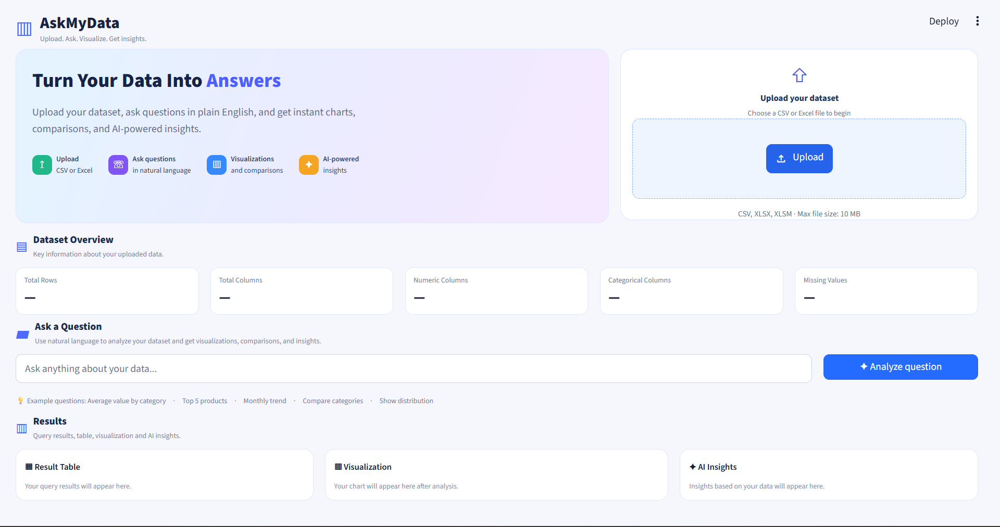
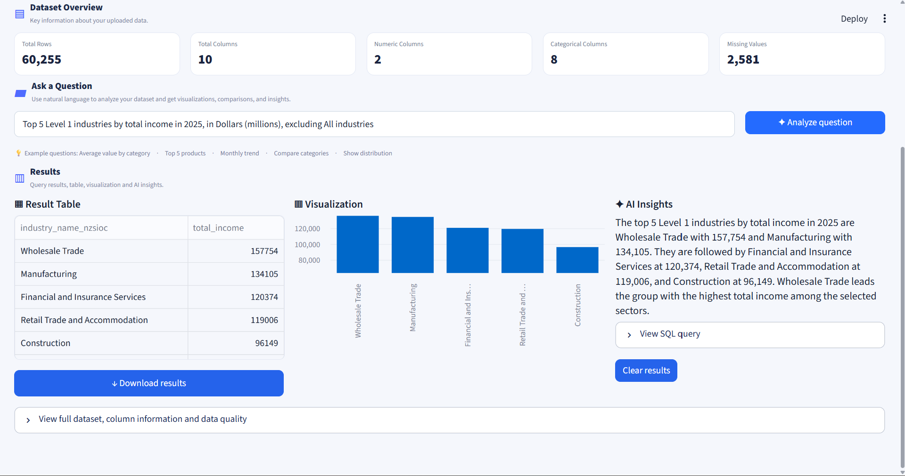

# 📊 AskMyData

Upload a CSV or Excel file, ask questions in plain English, and get a table, a chart and a short written answer.






## How it works

1. You upload a `.csv` or `.xlsx` file (max 10 MB, 200,000 rows, 60 columns).
2. The file is cleaned (tidy column names, dates and numbers detected) and loaded into an in-memory DuckDB table called `data`.
3. You type a question, for example "What is the total profit by region?".
4. Google Gemini turns the question into one DuckDB `SELECT` query. If the query fails, Gemini gets one chance to fix it.
5. A safety check (sqlglot) allows only a single read-only query on the `data` table.
6. The query runs with a 20 second timeout and a 1,000 row limit.
7. The app shows the result table, a chart, a plain-English explanation from Gemini, and the SQL used.

## Safety and privacy

- **SQL safety check:** only one `SELECT` (or `UNION`) is allowed, only on the uploaded table. Multiple statements, other tables, and file-reading functions such as `read_csv` are blocked.
- **Locked-down database:** DuckDB runs in memory with external file access disabled and its settings locked, with a memory limit and a query timeout.
- **Nothing is stored:** each session's data lives in memory and disappears when the session ends.
- **What is sent to Google:** to write the query and the explanation, the app sends Gemini your question, the column names and types, 3 sample rows, and up to 30 rows of the query result. Do not upload data you are not allowed to share with Google.

## Tech stack

Python, Streamlit, DuckDB, pandas, sqlglot, Google Gemini (`google-genai`).
Optional API backend: FastAPI, SQLAlchemy, Supabase (PostgreSQL).

## Project layout

```
frontend/app.py            Streamlit dashboard (the main app)
frontend/dataset_tool.py   file loading, cleaning, DuckDB, SQL safety check
tests/                     automated tests for the loader and the safety check
backend/                   optional FastAPI + Supabase API (separate from the dashboard)
.streamlit/config.toml     light theme
.env.example               template for your keys
```

## Run it locally

1. Clone the repo and create a virtual environment:

```
python -m venv venv
.\venv\Scripts\Activate.ps1          # Windows PowerShell
python -m pip install -r requirements.txt
```

2. Copy `.env.example` to `.env` and add your Gemini key (get one at https://aistudio.google.com):

```
GEMINI_API_KEY=your_key_here
```

3. Start the app from the project root:

```
python -m streamlit run frontend/app.py
```

4. Open http://localhost:8501 and upload a file.

If you see a "model not found" message, set `GEMINI_MODEL` in `.env` to a model your key can use.

## Example questions

For a sales dataset such as Superstore:

- What is the total profit by region?
- Top 5 products by sales
- Show total sales by year
- Which sub-categories lost money?
- Compare average discount by region

Questions the data cannot answer (for example "What's the weather?") are refused, and anything other than a read-only query is blocked.

## Run the tests

```
python -m pip install -r requirements-dev.txt
python -m pytest tests -q
```

## Optional: API backend

`backend/` is a separate FastAPI service that answers questions against a read-only Supabase (PostgreSQL) `sales` table. The dashboard does not need it. To run it, add `READONLY_DATABASE_URL` to `.env`, then:

```
python -m uvicorn main:app --reload --port 8010 --app-dir backend
```

Check it at http://localhost:8010/health.

## Sample analysis

`insights.md` summarizes findings from the Superstore dataset (2011–2014), for example that discounts of 30% or more lose money and that Central's margin fell sharply in 2014.
